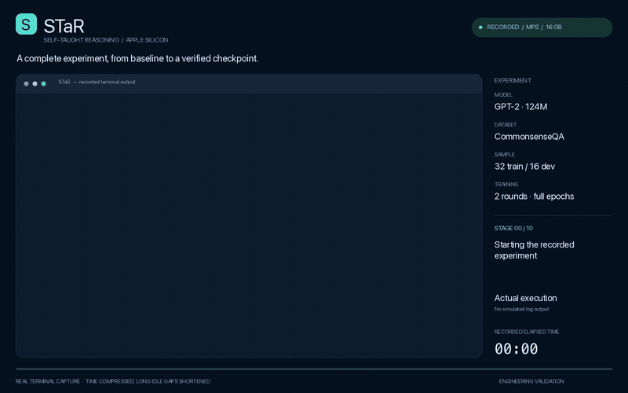

# STaR · Apple Silicon

**English** · [简体中文](README.zh-CN.md)

A local implementation of [STaR: Bootstrapping Reasoning With Reasoning](https://arxiv.org/abs/2203.14465), with **MPS GPU training and inference on Apple Silicon** and a CPU fallback. It preserves the central loop: generate rationales, keep answers that are correct, retry failed questions with an answer hint, remove that hint from the training input, and fine-tune a fresh copy of the original base model each round.

The default model is **GPT-2 124M**, with full-parameter fine-tuning. The complete workflow has been tested on a **16 GB M1 Pro**. This is an engineering adaptation, not a reproduction of GPT-J-6B scale or the paper's accuracy. GPT-J-6B's float32 weights, gradients, and Adam states alone require roughly 96 GB. See the [architecture and migration notes](docs/architecture.md) for differences from upstream commit `6ffd3c4`.

## Recorded demo

[](docs/media/star-e2e-demo.mp4)

**[Watch / download the MP4](docs/media/star-e2e-demo.mp4)** · [Experiment report](docs/experiments/2026-11-10-e2e/report.md) · [中文报告](docs/experiments/2026-11-10-e2e/report.zh-CN.md) · [Original terminal recording](docs/experiments/2026-11-10-e2e/terminal.cast)

The 82-second video is rendered from timestamped terminal output captured during the actual experiment. Playback is accelerated and long idle gaps are shortened; the recorded elapsed clock remains visible. The animated preview above plays at twice the MP4 speed; click it to open the full video. Machine-specific project paths are normalized. The MP4 link works independently of whether your Markdown viewer supports embedded video.

The experiment uses the default **32 training questions, 16 held-out validation questions, and two full epoch-based STaR rounds**, followed by independent checkpoint evaluation, inference, resume, and artifact audits. A separately labeled synthetic GPT-J fixture checks the successful rationalization branch. Its results are not included in the real model's accuracy.

**Recorded result:** 33 tests and 17 artifact checks passed. Held-out accuracy was **4/16 (25%) before training and 3/16 (18.75%) after round two**. The run validates the workflow; it did not improve accuracy on this small subset. See the report for all per-round results and limitations.

## Install

Use **macOS 14+, native arm64 Python 3.11 or 3.12**; Python 3.11 is recommended. Dependencies and pretrained weights need network access on their first download. No API key, cloud account, W&B account, or remote GPU is required.

```bash
# If a suitable Python version is not installed
brew install python@3.11

# From this repository
bash scripts/setup_mac.sh
source .venv/bin/activate
star doctor
```

The installer creates `.venv`, uses the tested versions in `requirements.lock`, and performs real forward/backward computation. `device: mps` means the Apple GPU is active. Use native arm64 Python rather than a Rosetta x86 installation.

Manual installation, also suitable for CPU/Linux:

```bash
python3.11 -m venv .venv
source .venv/bin/activate
pip install -r requirements.txt
# Development and test tools
pip install -c requirements.lock -e '.[dev]'
```

## Run an offline integration check

```bash
star smoke --device mps --output-dir runs/smoke
# CPU alternative; use a fresh output directory
star smoke --device cpu --output-dir runs/smoke-cpu-new
```

This creates a tiny GPT-J locally, deliberately fits it to a controlled fixture, and runs two real STaR rounds: generation, filtering, hinted recovery, training, checkpoint reload, unhinted evaluation, and resume. It downloads no model and uses no mocked generator.

**The smoke fixture intentionally overlaps training and evaluation questions. It tests integration, not reasoning generalization or paper performance.** Its `smoke_result.json` marks `fixture_only: true`. Existing outputs are never silently replaced; choose a new directory for a new run.

## Run the real tasks

```bash
# Original CommonsenseQA: 32 train questions, 16 dev questions, 2 rounds
star run --config configs/commonsenseqa.json

# Original GSM data
star run --config configs/gsm.json

# Generate independent few-shot, training, and validation arithmetic problems
star prepare-arithmetic --train-count 200 --eval-count 50 --max-digits 3
star run --config configs/arithmetic.json
```

If `datasets/arithmetic/` already contains generated data, run the arithmetic experiment directly. The generator will not overwrite it.

GPT-2 requires an approximately 0.5 GB initial weight download; subsequent runs use the Hugging Face cache. Task presets pin the model revision. Each experiment saves its own immutable base-model snapshot. Paths inside a configuration are resolved relative to that configuration file, so absolute config paths also work from other directories.

A small model may generate no valid, correct rationales, particularly for GSM or multi-digit arithmetic. Such an iteration is recorded as `skipped_no_correct_examples` and retains the previous model. Reference answers are never used to fabricate successful training data. Check `trained_iterations` to see how many rounds actually trained.

```bash
# Explicit CPU execution with separate outputs
star run --config configs/commonsenseqa.json --device cpu --output-dir runs/cpu-experiment

# After the required model files have been cached
star run --config configs/commonsenseqa.json --local-files-only --output-dir runs/offline

# Continue at an iteration boundary; all other settings and data must match
star run --config configs/commonsenseqa.json --resume --iterations 3
```

Resume replays an interrupted iteration from the beginning; it does not restore an intermediate optimizer step. Changes to learning rate, device, or sample size require a new experiment directory.

## Reproduce the recorded end-to-end experiment

```bash
python scripts/run_e2e.py \
  --device mps \
  --output-dir runs/my-e2e \
  --report-dir docs/experiments/my-e2e
```

This executes environment checks, the test suite, synthetic branch coverage, a real GPT-2 baseline, the full default STaR experiment, independent evaluation of the saved checkpoint, inference, resume, and an independent artifact audit. It does not cap training to one or two optimizer steps. It records a timestamped `terminal.cast`, command logs, stage durations, the exact config, source hashes, per-question results, and `result.json`.

To render your own recording, install the optional video tools separately from the training runtime:

```bash
brew install ffmpeg
python -m pip install Pillow==12.3.0
python scripts/render_demo.py \
  --report-dir docs/experiments/my-e2e \
  --output docs/media/my-e2e.mp4
```

The renderer supports macOS system fonts and DejaVu fonts on Linux. It produces an MP4, a poster, a midpoint inspection frame, and JSON describing the timing transformation. The original recording retains real event timestamps.

## Inference, evaluation, and fine-tuning separately

```bash
star generate --config configs/commonsenseqa.json --prompt 'Q: What is a pen used for? A:'

# If this round trained successfully; summary.json contains the actual final model path
star evaluate --config configs/commonsenseqa.json \
  --model runs/commonsenseqa/iteration_0002/model --output-dir runs/evaluation

star train --config configs/commonsenseqa.json \
  --records runs/commonsenseqa/iteration_0001/accepted.jsonl \
  --output-dir runs/manual-finetune
```

`train` starts from the configured base model unless `--model` overrides it. It checks that each completion's final answer matches the record's answer. The experiment-generated `accepted.jsonl` contains hint-free training prompts. `evaluate` never provides answer hints.

Every command also works as `python -m star ...`. Use `--model` and `--revision` for another Hugging Face causal LM with a fast tokenizer and safetensors weights, or point to a local model directory containing weights, config, and tokenizer. A different model's capabilities and memory requirements need separate validation.

## Configuration and memory

Task presets contain only task-specific overrides. Shared defaults live in [`Config`](src/star/config.py). Unknown settings fail explicitly.

| Setting | Default | Meaning |
| --- | --- | --- |
| `device` | `auto` | MPS when available, otherwise CPU; explicit `mps` never silently falls back |
| `max_seq_length` / `max_new_tokens` | 512 / 96 | Total context budget and generation limit; leave room for the question |
| `generation_batch_size` / `batch_size` | 1 / 1 | Generation batch and training microbatch sizes |
| `gradient_accumulation_steps` | 4 | Accumulated microbatches per update; the final partial group is retained |
| `gradient_checkpointing` | true | Recompute activations to reduce training memory |
| `few_shot` / `few_shot_train` | 3 / false | Demonstration count; omit demonstrations from training inputs by default |
| `rationalize` / `rationalization_probability` | true / 1.0 | Retry incorrect answers with hints, at the configured sampling rate |
| `temperature` / `top_p` | 0 / 0.9 | Greedy by default; positive temperature enables nucleus sampling |
| `learning_rate` / `weight_decay` | 1e-5 / 0 | Constant AdamW learning rate and weight decay |
| `epochs` / `add_epochs` | 1.0 / 0.2 | Round t uses `epochs + add_epochs × (t−1)` epochs |
| `max_steps` / `add_steps` | null / 0 | Optional fixed optimizer-update count and per-round increment |
| `loss_mask` | `completion` | Train on the current rationale, answer, and EOS; `all` is the unmasked control |
| `direct` | false | Use direct-answer demonstrations as a baseline |
| `seed` | 42 | Controls data selection, model randomness, and retry sampling |

The runtime uses float32 and eager attention, with no CUDA-specific dependencies. Keep batch sizes at 1 on memory-constrained systems. Reduce context length or use a smaller model if needed. CPU and MPS execution are not guaranteed to be bitwise identical.

Each trained iteration saves a complete checkpoint, in addition to the initial snapshot. Disk usage grows with the number of rounds. Keep historical checkpoints while you still need to resume that experiment.

## Layout and artifacts

```text
src/star/          Algorithm, data adapters, PyTorch backend, CLI, offline fixture
configs/           Task presets
datasets/          Original data and demonstrations; generated arithmetic is ignored
scripts/           Mac setup, recorded E2E runner, video renderer
tests/             Algorithm invariants, boundary cases, real training and device tests
docs/              Migration notes, experiment reports, and demo video
requirements.lock  Tested dependency constraints
runs/              Local checkpoints and experiment outputs; ignored by Git
```

An experiment contains `manifest.json`, `base_model/`, each round's `generations.jsonl`, `accepted.jsonl`, `evaluation.jsonl`, `metrics.json`, and `model/`, plus a final `summary.json`. Generation logs retain hinted inputs for inspection; accepted training prompts remove those hints. Compact report evidence and the demo are kept in the repository; model weights remain local.

## Tests and attribution

```bash
pytest -q
ruff check src tests
ruff format --check src tests
```

Tests cover partial batches, hint removal, retry selection, fresh-base training, empty accepted sets, interrupted iteration replay, checkpoint integrity, loss masks, context limits, and MPS forward/backward computation. CI defines CPU tests and the offline integration run. See the [earlier platform validation](docs/validation.md) and the [recorded experiment report](docs/experiments/2026-11-10-e2e/report.md) for checks actually performed.

Retain the [original citation](CITATION.bib) and [Apache 2.0 license](LICENSE.txt), and cite the [STaR paper](https://openreview.net/forum?id=_3ELRdg2sgI). This adaptation does not claim the original paper's evaluation results.
