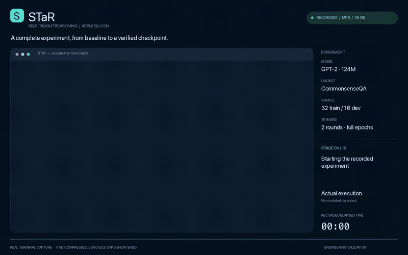

# STaR · Apple Silicon

[English](README.md) · **简体中文**

[STaR: Bootstrapping Reasoning With Reasoning](https://arxiv.org/abs/2203.14465) 的本地可运行实现，支持 M1/M2/M3 等 Apple Silicon 的 **MPS GPU 训练与推理**，也可使用 CPU。保留“生成推理 → 答案筛选 → 对错题提示答案后重新推理 → 去掉输入中的提示 → 每轮从初始模型重新微调”的核心流程。

默认使用 GPT-2 124M 做全参数微调，降低 8/16 GB Mac 的内存需求；已在 16 GB M1 Pro 上实测完整流程。**这不等于在 M1 上复现 GPT-J-6B 的参数规模或论文准确率**。GPT-J-6B 的 float32 权重、梯度和 Adam 状态本身约需 96 GB；更换后端无法消除这个容量限制。模型架构与大小可以配置。

原始代码依据 `6ffd3c4`。已移除本地流程不再使用的 TPU/Ray/GCS/TFRecord/Docker 代码；算法对应关系、修复及数值差异见 [迁移说明](docs/architecture.md)，实机结果见 [验证记录](docs/validation.md)。

## 实验 Demo

[](docs/media/star-e2e-demo.mp4)

**[观看 / 下载 MP4](docs/media/star-e2e-demo.mp4)** · [中文实验报告](docs/experiments/2026-11-10-e2e/report.zh-CN.md) · [English report](docs/experiments/2026-11-10-e2e/report.md) · [原始终端记录](docs/experiments/2026-11-10-e2e/terminal.cast)

82 秒视频根据本次真实实验期间捕获的带时间戳终端输出渲染。播放经过加速，长时间等待已缩短，画面保留实际经过的时间。上方动态预览以 MP4 的两倍速度播放，点击可打开完整视频；机器专属的项目路径已统一为相对路径。MP4 链接可独立打开，不依赖 Markdown 阅读器是否支持内嵌视频。

实验使用默认的 **32 道训练题、16 道独立验证题、两轮完整 epoch 训练**，随后执行 checkpoint 独立评估、推理、断点恢复及产物审计。单独标注的小型 GPT-J 合成夹具用于验证成功 rationalization 分支，其结果不计入真实模型准确率。

**本次结果：**33 项测试、17 项产物检查通过；独立验证准确率从训练前的 **4/16（25%）** 变为第二轮后的 **3/16（18.75%）**。本次验证了完整流程，但没有提升该小规模子集上的准确率。完整逐轮结果和局限见实验报告。

## 安装

需要 **macOS 14+、原生 arm64 Python 3.11 或 3.12**，推荐 Python 3.11。首次下载依赖和预训练模型需要网络；不需要 API key、Google Cloud、W&B 或远程 GPU。

```bash
# 如果尚未安装合适的 Python
brew install python@3.11

# 在项目根目录执行
bash scripts/setup_mac.sh
source .venv/bin/activate
star doctor
```

安装脚本创建项目内的 `.venv`，使用 `requirements.lock` 中的已验证版本，并实际检查设备前向/反向计算。输出中的 `device: mps` 表示使用 Apple GPU。不要使用 Rosetta 下的 x86 Python。

也可手动安装；CPU/Linux 可使用相同的 Python 包：

```bash
python3.11 -m venv .venv
source .venv/bin/activate
pip install -r requirements.txt
# 开发和测试工具
pip install -c requirements.lock -e '.[dev]'
```

## 先做离线完整检查

```bash
star smoke --device mps --output-dir runs/smoke
# CPU 备用路径
star smoke --device cpu --output-dir runs/smoke-cpu-new
```

这会在本地建立一个约 13 万参数的 GPT-J，先在刻意构造的小型样例上拟合，再真实执行两轮 STaR，覆盖正确样本筛选、错题提示恢复、全参数训练、checkpoint 重载、无提示评估和恢复已完成实验。检查不下载模型、不使用模拟生成器。

**smoke 里的问题、答案和预拟合模型是测试夹具，训练与评估题目有意重叠，不能作为推理泛化或论文性能证据。** `smoke_result.json` 会明确标记 `fixture_only: true`。重复测试请使用新的输出目录。

## 运行仓库中的真实任务

```bash
# 原始 CommonsenseQA 数据；默认 32 道训练题、16 道验证题、2 轮
star run --config configs/commonsenseqa.json

# 原始 GSM 数据
star run --config configs/gsm.json

# 生成加法数据；few-shot、训练和验证问题彼此独立
star prepare-arithmetic --train-count 200 --eval-count 50 --max-digits 3
star run --config configs/arithmetic.json
```

若 `datasets/arithmetic/` 已有生成的数据，直接执行对应的 `run` 命令即可；生成命令不会覆盖已有数据。

GPT-2 的首次权重下载约 0.5 GB，之后使用 Hugging Face 本地缓存。配置固定了模型 revision；模型文件保存在缓存中，实验使用自己的不可变基座快照。输出路径和数据路径均相对于配置文件解析，因此命令也可从其他工作目录使用绝对配置路径调用。

小模型可能无法生成格式正确且答案正确的推理，尤其是 GSM 和多位数加法。如果某轮没有成功样本，会记录 `skipped_no_correct_examples` 并保留之前模型，不会拿参考答案伪造训练数据。`trained_iterations` 才是实际训练的轮数。需要更好的推理效果时可更换能放入内存、提供 fast tokenizer 和 safetensors 的 Transformers causal LM；这会改变模型能力，须另做实验。

```bash
# 强制 CPU；用新目录保存不同实验
star run --config configs/commonsenseqa.json --device cpu --output-dir runs/cpu-experiment

# 所需模型已经缓存后离线运行
star run --config configs/commonsenseqa.json --local-files-only --output-dir runs/offline

# 从完成的迭代边界继续；其他配置和数据必须一致
star run --config configs/commonsenseqa.json --resume --iterations 3
```

中断的一轮会完整重跑；不恢复 optimizer step 中途状态。不能通过 `--resume` 改学习率、设备或样本数。不同实验应指定新输出目录。

## 复现录制的端到端实验

```bash
python scripts/run_e2e.py \
  --device mps \
  --output-dir runs/my-e2e \
  --report-dir docs/experiments/my-e2e
```

该命令依次执行环境检查、测试集、合成分支验证、真实 GPT-2 基线、默认配置的完整 STaR 实验、保存模型的独立评估、推理、断点恢复和独立产物检查。训练步数由完整 epoch 计算，不限制为一两步。输出包括带时间戳的 `terminal.cast`、逐命令日志、阶段耗时、实际配置、源码哈希、逐题结果和 `result.json`。

如需渲染自己的录制，单独安装可选视频工具：

```bash
brew install ffmpeg
python -m pip install Pillow==12.3.0
python scripts/render_demo.py \
  --report-dir docs/experiments/my-e2e \
  --output docs/media/my-e2e.mp4
```

渲染器支持 macOS 系统字体和 Linux DejaVu 字体，生成 MP4、封面、用于检查的中间帧以及时间变换说明 JSON。原始录制文件保留真实事件时间。

## 单独推理、评估和微调

```bash
star generate --config configs/commonsenseqa.json --prompt 'Q: What is a pen used for? A:'

# 若该轮实际训练成功，使用其 checkpoint；最终路径以 summary.json 的 model 字段为准
star evaluate --config configs/commonsenseqa.json \
  --model runs/commonsenseqa/iteration_0002/model --output-dir runs/evaluation

star train --config configs/commonsenseqa.json \
  --records runs/commonsenseqa/iteration_0001/accepted.jsonl \
  --output-dir runs/manual-finetune
```

`train` 默认从配置的初始模型开始训练，`--model` 可以指定其他本地模型或 Hub 模型；它会检查 JSONL 中 completion 的最终答案是否符合记录中的 answer。实验循环生成的 `accepted.jsonl` 已去除输入中的答案提示。`evaluate` 始终不提供答案提示。

所有命令也支持 `python -m star ...`。使用其他 Hub 模型时可通过 `--model` 和 `--revision` 指定模型与版本；本地模型目录需包含权重、配置和 tokenizer。

## 配置与内存

配置文件只列出任务差异，统一默认值在 [`Config`](src/star/config.py)。未知配置项会直接报错。

| 配置 | 默认值 | 含义 |
| --- | --- | --- |
| `device` | `auto` | MPS 可用时使用 MPS，否则 CPU；显式 `mps` 不会静默退回 CPU |
| `max_seq_length` / `max_new_tokens` | 512 / 96 | 总上下文与生成长度；必须给当前问题留足空间 |
| `generation_batch_size` / `batch_size` | 1 / 1 | 生成批次与训练微批次，适合统一内存有限的机器 |
| `gradient_accumulation_steps` | 4 | 累积更新；尾批仍参与训练 |
| `gradient_checkpointing` | true | 重计算激活以降低训练内存 |
| `few_shot` / `few_shot_train` | 3 / false | 推理示例数；默认不把 few-shot 示例放入训练输入 |
| `rationalize` / `rationalization_probability` | true / 1.0 | 是否对错题给答案提示重试、重试比例 |
| `temperature` / `top_p` | 0 / 0.9 | 默认贪心；温度大于零时使用 nucleus 采样 |
| `learning_rate` / `weight_decay` | 1e-5 / 0 | AdamW 恒定学习率与权重衰减 |
| `epochs` / `add_epochs` | 1.0 / 0.2 | 第 t 轮训练 epoch 数为 `epochs + add_epochs × (t−1)` |
| `max_steps` / `add_steps` | null / 0 | 如指定，改为固定优化器更新次数及逐轮增量 |
| `loss_mask` | `completion` | 只训练当前推理、答案和 EOS；`all` 是不屏蔽问题的对照 |
| `direct` | false | 使用直接回答的 few-shot 示例，作为无推理提示基线 |
| `seed` | 42 | 控制数据抽样、模型随机性与重试抽样 |

所有本地计算使用 float32，使用 eager attention，不需要 CUDA 专用包。8 GB 设备建议先保持 batch 为 1；内存不足时减小上下文和生成长度，或更换更小模型。CPU 使用同一算法，但速度依模型和机器而异。CPU 与 MPS 不保证逐位一致。

每个成功训练的迭代保存一个完整 checkpoint，另外保留一份初始模型。磁盘使用会随轮数增长；`--resume` 需要这些文件。不要在实验仍需恢复时删除其历史模型。

## 目录与产物

```text
src/star/          算法、数据、PyTorch 后端、CLI、离线验证
configs/           三个任务的配置
datasets/          原始数据和提示；生成的 arithmetic 数据不入 Git
scripts/           Mac 安装、端到端实验录制与视频渲染
tests/             算法不变量、数据边界、真实训练和设备测试
docs/              迁移分析、实验报告与 Demo 视频
requirements.lock  已验证依赖约束
runs/              本地实验产物，不入 Git
```

实验目录包含 `manifest.json`、`base_model/`、每轮的 `generations.jsonl`、`accepted.jsonl`、`evaluation.jsonl`、`metrics.json`、`model/` 以及最终 `summary.json`。生成日志保留提示输入以便核查，训练数据中的 prompt 不含这些答案提示。

小体积的实验记录与视频保存在项目目录中，模型权重仍仅留在被 Git 忽略的 `runs/` 下。

## 测试与引用

```bash
pytest -q
ruff check src tests
ruff format --check src tests
```

测试覆盖尾批、提示移除、只重试错题、每轮基座重置、无成功样本、断点重放、checkpoint 完整性、训练掩码、上下文边界及 MPS 前向/反向。CI 执行 CPU 测试与离线完整流程；MPS 在支持的 Mac 上额外验证。

请保留 [原项目引用](CITATION.bib) 与 [Apache 2.0 许可证](LICENSE.txt)，并引用 [STaR 论文](https://openreview.net/forum?id=_3ELRdg2sgI)。本地适配未重新宣称原作者论文中的评测结果。
