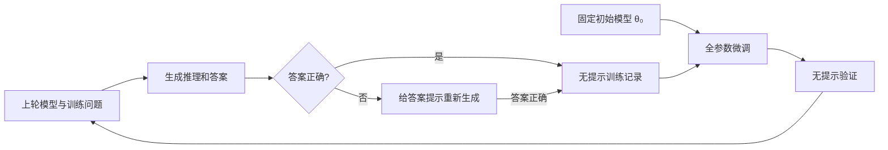

# 核心逻辑与迁移说明

本地实现依据原仓库提交 [`6ffd3c4`](https://github.com/ezelikman/STaR/tree/6ffd3c4743da6c7a7369834c434359d9f7e0ac38)。核心参考是 [`iteration_train.py`](https://github.com/ezelikman/STaR/blob/6ffd3c4743da6c7a7369834c434359d9f7e0ac38/iteration_train.py)、`device_inference.py`、`device_train.py` 和 `mesh_transformer/transformer_shard.py`，以及 [STaR 论文](https://arxiv.org/abs/2203.14465)。

## 算法保持不变

记初始模型为 θ₀，第 t 轮生成模型为 θₜ₋₁：

1. 给 θₜ₋₁ 少量带推理过程的示例，让它回答训练集问题。
2. 根据最终答案保留成功样本，而不是根据模型自评分。
3. 对失败样本按配置概率提供正确答案提示，再让同一个模型生成推理过程。仍然只有最终答案正确的样本会被接受。
4. 构造训练记录时使用**无提示的问题 + 模型实际生成的推理和答案**。不会用标准答案替换模型输出，也不会把 GSM 的人工参考解题过程当作自生成推理。
5. 每轮重新加载 **θ₀**，建立全新的 AdamW 优化器，在当轮成功样本上做全参数微调，得到 θₜ。生成使用上轮模型，训练从初始模型开始，这是两个不同的步骤。
6. 对验证集做无答案提示的评估，再进入下一轮。

没有引入远程教师模型、API 推理、LoRA、强化学习或量化训练。默认使用 GPT-2 是对统一内存容量的取舍，不代表模型架构、参数量或论文指标与 GPT-J-6B 等价。离线检查则使用原论文模型家族的小型 GPT-J。

## 源码对应关系

| 原实现 | 本地实现 | 作用 |
| --- | --- | --- |
| `iteration_train.py` | `src/star/pipeline.py` | 迭代调度、固定基座重训 |
| `device_inference.py` | `src/star/data.py`、`pipeline.py`、`backend.py` | 提示、生成、答案验证和 rationalization |
| `create_finetune_tfrecords.py`、`tfrecord_loader.py` | `data.py`、`backend.py` | JSONL 记录、tokenize、padding 和训练批次 |
| `device_train.py`、`mesh_transformer/` | `backend.py`、Transformers 原生模型类 | 自回归损失、梯度累积、模型前向和反向 |
| `arithmetic/gen_sums.py` | `star prepare-arithmetic` | 确定性的加法数据与 scratchpad 示例 |
| 云端 checkpoint、W&B | `runs/` 中的 safetensors、JSON、JSONL | 模型快照、日志、指标及恢复 |

## 有意修复的问题和数值差异

- 原 `device_train.train_step()` 构造了 `mask`，但 `CausalTransformer.train()` 只传递 `obs` 与 `target`，实际未应用这个 loss mask。本地默认按 tokenizer 的字符偏移标记问题/示例为 `-100`，只监督当前 completion 和 EOS。选择 `loss_mask: "all"` 可进行无问题掩码的对照实验；这不是逐位复现原 TPU 训练。
- 原 mask 通过固定 GPT-2 token ID `25`（冒号）与 `50256`（EOS）寻找边界，容易将推理内部的冒号误认为答案开头。本地使用明确的 `prompt` / `completion` 字段，不依赖某一 tokenizer 的 token ID。
- 原推理只处理完整 batch，循环结束后剩余问题和待重推理问题可能被丢弃。新实现保留所有尾批，梯度累积最后不足一组时也会执行更新，并按实际监督 token 数归一化。
- 保留交叉熵和原代码 max-shifted logits 形式的 z-loss（默认系数 `1e-4`），使用 float32；不复刻 TPU 的 bfloat16、跨卡规约或样本拼接顺序。AdamW 默认不使用 weight decay，与原 STaR 配置一致。
- 原默认使用温度 `0.01` 的近贪心采样。本地默认 `temperature: 0` 做贪心生成以方便验证；设置 `0.01`、`top_p: 0.9` 可采用原采样参数。随机种子可控制采样，但 CPU 与 MPS 不保证逐位一致。
- 默认保持恒定学习率。每轮训练量可用 `epochs + add_epochs × (t−1)` 或 `max_steps + add_steps × (t−1)` 设置。`max_steps` 表示本轮优化器更新次数，不是 token 数。
- 原 `commonsenseqa` / `cqa` 目录混用、缺少 GSM 的 direct prompt、加法数据生成路径与加载路径不一致均已统一。
- 数值答案支持千位逗号与等值小数；选项必须有可解析的最终标签，GSM 必须有 `####`，scratchpad 必须闭合。不从下一个生成问题中寻找正确答案。
- 超出上下文时先移除完整 few-shot 示例；当前问题不会被截断。超长训练记录会被完整丢弃并计数，不会截掉最终答案后继续训练。若所有记录均超长则明确失败。
- 没有正确生成时本轮状态为 `skipped_no_correct_examples`，保留之前模型并继续评估。不会伪造训练样本或声称已经训练。

## 运行与恢复边界

实验第一次运行会复制基座权重与 tokenizer 到 `base_model/`，记录模型 revision、配置、选定数据和提示的 SHA-256，以及基座文件的哈希。每轮只同时保留一个模型在设备内存中；模型阶段结束后释放对象与 MPS 缓存。

每轮输出 `generations.jsonl`（包括失败及提示尝试）、`accepted.jsonl`、`evaluation.jsonl` 和 checkpoint。只有完整完成评估后才原子写入 `metrics.json`，作为这一轮的提交标志。

`--resume` 验证配置、选定数据、提示和 checkpoint，跳过完成的轮次，**重跑未完成的整轮**。不支持在某个 optimizer step 中间恢复。初始化基座尚未写入 manifest 时发生中断，需要换一个输出目录重新运行。除增加 `iterations` 外，其他实验设置需要新目录。输出目录有进程锁，避免两次运行同时写入。

## 为什么不直接升级旧 JAX

原实现使用 JAX 0.2.12 / jaxlib 0.1.68 的 `xmap`、8 路 TPU mesh、Ray 1.4.1、TensorFlow 2.6、GCS 和固定分片 checkpoint。它的运行前提不是一个 Mac 上的单个 Metal GPU。仅替换依赖版本不能保留可执行的调用链。

本地使用 [PyTorch MPS](https://docs.pytorch.org/docs/2.8/notes/mps.html) 和 Transformers 模型类，把模型并行、TFRecord 与远端文件系统替换成单设备计算、JSONL 与本地 safetensors。使用 eager attention 和 float32 以兼容 M1，未依赖 CUDA、FlashAttention 或 bitsandbytes。

[GPT-J 官方 Transformers 文档](https://huggingface.co/docs/transformers/model_doc/gptj)也明确区分了推理和 Adam 微调的内存需求。6B 参数单是 float32 权重约需 24 GB，权重、梯度和两个 Adam 状态约需 96 GB，还不包括激活。因此 8/16 GB M1 无法全参数复现 GPT-J-6B；本地代码会在下载权重前估算并拒绝明显超出物理内存的模型。

## 清理原则

迁移完成后移除了旧 TPU 的模型分片实现、Ray/GCE/GCS 管理、Docker 部署、TFRecord 转换、TPU notebook、失效配置和旧依赖清单。它们不在本地执行链上，继续放在根目录会形成两个互不兼容的项目入口。原始实现完整保存在上述 Git 提交中，可通过 `git show 6ffd3c4:文件路径` 查看。

保留原始数据、few-shot 示例、许可证与引用信息；统一为 `src/star/`、`datasets/`、`configs/`、`tests/`、`docs/`。历史 GPT-J benchmark 表未作为本地运行结果保留。平台适配验证见 [validation.md](validation.md)，完整默认配置的录制实验见 [端到端报告](experiments/2026-11-10-e2e/report.zh-CN.md)。
