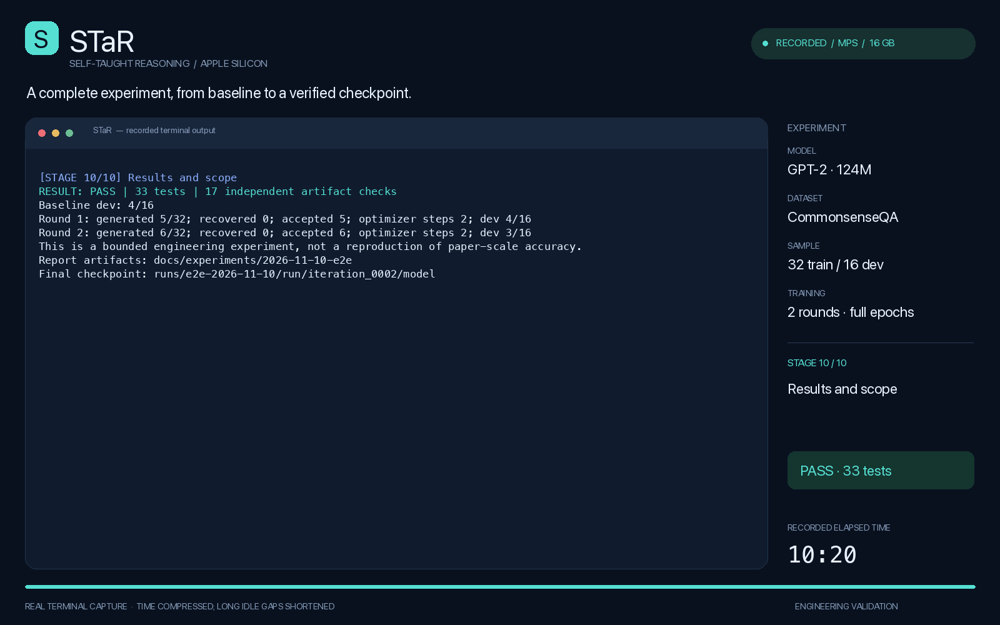

# Recorded end-to-end experiment · 2026-11-10

**English** · [简体中文](report.zh-CN.md) · [Project README](../../../README.md)

**Outcome: PASS.** One fresh execution completed the real default STaR workload, saved and reloaded its checkpoints, reproduced final evaluation, and resumed without changing committed artifacts. 33 tests and 17 independent artifact checks passed. This is a bounded engineering test, not a full-dataset or paper-scale benchmark.

[](../../media/star-e2e-demo.mp4)

[Watch / download MP4](../../media/star-e2e-demo.mp4) · [Original terminal recording](terminal.cast)

## Experimental setup

- Apple M1 Pro, 16 GiB unified memory, macOS 26.6.1, native arm64.
- Python 3.11.16, PyTorch 2.8.0, Transformers 4.51.3; explicit **MPS**, float32.
- Pretrained `openai-community/gpt2`, revision `607a30d783dfa663caf39e06633721c8d4cfcd7e`. The baseline is pretrained GPT-2 **before STaR fine-tuning**, not randomly initialized weights.
- Original CommonsenseQA: first 32 training questions after shuffling with seed 42, first 16 validation questions in file order. Training and validation questions are disjoint.
- Two rounds, 1.0 then 1.2 epochs; batch size 1; gradient accumulation 4; AdamW learning rate 1e-5; no weight decay; completion-only loss; gradient checkpointing on.
- `max_steps: null`: no artificial optimizer-step cap. All accepted examples are used. Actual updates depend on how many generated answers are correct.
- Up to three whole few-shot demonstrations within a 512-token context, up to 96 new tokens, greedy generation; answer-hinted retries enabled for every failed training question.
- UTC start: `2026-11-10T01:31:48.514477+00:00`; finish: `2026-11-10T01:42:08.829140+00:00`. Recorded wall time: **620.32 s (10.34 min)**. Weights were already cached; dependency installation and the first download are not included.

## Results

Baseline held-out accuracy: **4/16 (25.00%)**.

| Round | Correct without hints | Hinted retries | Recovered | Accepted records | Held-out accuracy |
| --- | --- | --- | --- | --- | --- |
| 1 | 5/32 | 27 | 0 | 5 | 4/16 (25.00%) |
| 2 | 6/32 | 26 | 0 | 6 | 3/16 (18.75%) |

| Round | Epochs | Example presentations | Optimizer updates | Mean training loss | Training seconds |
| --- | --- | --- | --- | --- | --- |
| 1 | 1.0 | 5 | 2 | 3.257249 | 2.58 |
| 2 | 1.2 | 8 | 2 | 3.452213 | 2.06 |

Final held-out accuracy: **3/16 (18.75%)**, a change of **-6.25 percentage points** from baseline. This run did not improve held-out accuracy. With only 16 validation questions, this is not reliable evidence of a generalization gain. A passing integration test does not imply strong reasoning quality. The acceptance criterion checks final answers; rationale correctness is not independently graded. Losses from different rounds use different accepted samples and are not a comparable learning curve.

## End-to-end coverage

1. Check actual MPS forward/backward execution and run all 33 tests.
2. Run a clearly separated, deliberately fitted tiny GPT-J fixture through two rounds. It exercises successful answer-hinted recovery. Its overlapping train/evaluation examples and results are **excluded** from the real-model metrics above.
3. Evaluate the untouched pretrained GPT-2 baseline on the held-out subset.
4. Run two complete rounds: unhinted generation, correct-answer filtering, hinted retries, hint-free training-record construction, full-parameter training from the original base, checkpoint save, and unhinted evaluation.
5. Reload the final checkpoint in a separate process and evaluate again; per-question predictions and aggregate metrics exactly match the final in-loop evaluation. Also generate a new completion from that saved checkpoint.
6. Resume the completed experiment and verify that all committed run content remains byte-identical.
7. Independently recompute acceptance, verify every failed question was retried, confirm no hints entered training prompts, confirm all accepted records were visited, check the expected update count, verify base/model hashes and recorded initialization paths, and reject any hinted dev evaluation.

All 17 recorded checks passed. Full details: [result.json](result.json).

## Recorded stages

| Stage | Operation | Real seconds |
| --- | --- | --- |
| 1 | Environment and MPS execution | 2.93 |
| 2 | Tests and dependency consistency | 4.28 |
| 3 | Controlled GPT-J branch coverage (synthetic fixture) | 12.08 |
| 4 | Untrained GPT-2 baseline on the held-out dev subset | 51.69 |
| 5 | Two complete STaR rounds on original CommonsenseQA | 483.90 |
| 6 | Reload the final checkpoint and independently evaluate | 53.67 |
| 7 | Generate from the saved checkpoint | 6.82 |
| 8 | Resume without retraining or changing committed artifacts | 3.39 |
| 9 | Independent artifact audit | 1.56 |
| 10 | Results and scope | 0.00 |

Timings describe this machine during this run, not isolated performance benchmarks. The console stage labeled “Untrained GPT-2 baseline” means before STaR fine-tuning; it uses pretrained GPT-2.

## Video provenance

The MP4 is **82.17 seconds**, 1600×1000, H.264/YUV420p at 12 fps, with no audio. It was rendered from the actual PTY recording, not from reconstructed success messages. All 176 output events are processed in their original order. Playback uses 5× timing with individual idle gaps capped at 2 seconds, plus opening/closing holds and a minimum three-second display per stage for readability. The on-screen clock shows recorded time. The original `.cast` retains real event timestamps; only the machine-specific project path prefix was normalized during capture.

The animated README preview runs faster than the MP4. The full MP4, poster, preview and their encoding metadata are in [docs/media](../../media). Rendering logic: [render_demo.py](../../../scripts/render_demo.py).

## Evidence and reproduction

| Artifact | Contents |
| --- | --- |
| [config.json](config.json) | Resolved experimental configuration / 实验配置 |
| [result.json](result.json) | Hardware, metrics, assertions / 硬件、指标、检查结果 |
| [manifest.json](manifest.json) | Model revision, data digest, base checkpoint hashes / 模型及数据指纹 |
| [source-sha256.json](source-sha256.json) | Exact runtime source identities / 执行源码指纹 |
| [stages.json](stages.json) | Commands, exit codes, real durations / 命令、退出码和真实耗时 |
| [terminal.cast](terminal.cast) | Complete timestamped terminal recording / 完整终端录制 |
| [baseline-predictions.jsonl](baseline-predictions.jsonl) | Baseline results for all 16 questions / 基线逐题结果 |
| [Round 1](iteration_0001/generations.jsonl), [Round 2](iteration_0002/generations.jsonl) | All raw generations and hinted retries / 原始生成与提示重试 |
| [Round 1 accepted](iteration_0001/accepted.jsonl), [Round 2 accepted](iteration_0002/accepted.jsonl) | Actual hint-free training records / 实际无提示训练记录 |
| [reloaded-predictions.jsonl](reloaded-predictions.jsonl) | Independent saved-checkpoint evaluation / 重载后的独立评估 |
| [saved-model-generation.json](saved-model-generation.json) | A new completion from the saved model / 保存模型的独立推理 |
| [artifacts.sha256](artifacts.sha256) | Report and media file hashes / 报告与媒体校验值 |

```bash
source .venv/bin/activate
python scripts/run_e2e.py --device mps \
  --output-dir runs/e2e-reproduction \
  --report-dir docs/experiments/e2e-reproduction
```

Use fresh directories. This reproduces the experimental procedure; CPU/GPU and library differences can change numerical results. Local weights from this execution are at `runs/e2e-2026-11-10/run/iteration_0002/model`. They are ignored by Git, while the compact report evidence and video stay in the project. See [README](../../../README.md) for setup and video-rendering commands.
