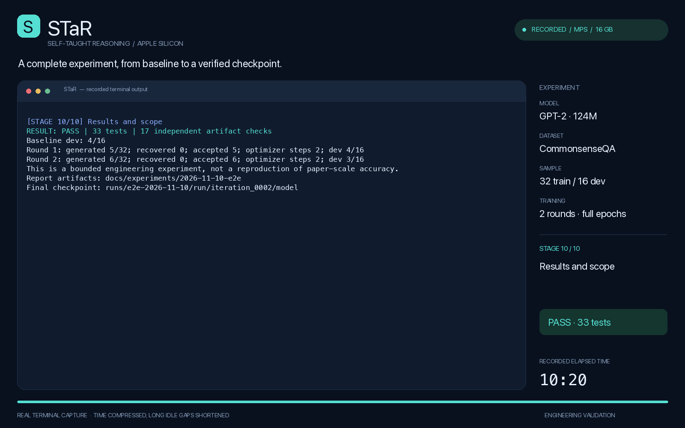

# 端到端录制实验 · 2026-11-10

[English](report.md) · **简体中文** · [项目说明](../../../README.zh-CN.md)

**结果：通过。** 本次从新输出目录启动，完成默认规模的真实 STaR 实验、模型保存与重载、独立评估和断点恢复。33 项测试及 17 项独立产物检查通过。本实验验证工程流程，不是完整数据集或论文规模的性能复现。

[](../../media/star-e2e-demo.mp4)

[观看 / 下载 MP4](../../media/star-e2e-demo.mp4) · [原始终端录制](terminal.cast)

## 实验设置

- Apple M1 Pro，16 GiB 统一内存，macOS 26.6.1，原生 arm64。
- Python 3.11.16、PyTorch 2.8.0、Transformers 4.51.3；明确使用 **MPS**，float32。
- 预训练 `openai-community/gpt2`，固定 revision：`607a30d783dfa663caf39e06633721c8d4cfcd7e`。基线是 STaR 微调前的预训练 GPT-2，不是随机初始化模型。
- 原始 CommonsenseQA：训练集按 seed=42 打乱后取 32 题；验证集按文件顺序取前 16 题。训练与验证问题互不重叠。
- 两轮分别训练 1.0 和 1.2 epochs；batch=1，梯度累积=4，AdamW 学习率 1e-5、weight decay=0；仅监督 completion，开启梯度检查点。
- `max_steps: null`，没有人为截断优化器更新次数。每个被接受的样本均参与训练，实际步数由正确生成样本数计算。
- 最多 3 个完整 few-shot 示例（超预算时移除完整示例），512-token 上下文，最多生成 96 tokens，贪心生成；对所有答错训练题提供答案提示重试。
- 开始 UTC：`2026-11-10T01:31:48.514477+00:00`；结束 UTC：`2026-11-10T01:42:08.829140+00:00`。实际录制耗时 **620.32 秒（10.34 分钟）**。权重已缓存，耗时不包含首次依赖安装和下载。

## 实验结果

微调前独立验证准确率：**4/16 (25.00%)**。

| 轮次 | 无提示正确 | 提示重试 | 提示后恢复 | 保留训练记录 | 独立验证准确率 |
| --- | --- | --- | --- | --- | --- |
| 1 | 5/32 | 27 | 0 | 5 | 4/16 (25.00%) |
| 2 | 6/32 | 26 | 0 | 6 | 3/16 (18.75%) |

| 轮次 | Epochs | 样本训练次数 | 优化器更新 | 平均训练 loss | 训练秒数 |
| --- | --- | --- | --- | --- | --- |
| 1 | 1.0 | 5 | 2 | 3.257249 | 2.58 |
| 2 | 1.2 | 8 | 2 | 3.452213 | 2.06 |

最终独立验证准确率为 **3/16 (18.75%)**，相对基线变化 **-6.25 个百分点**。本次实验没有提高独立验证集准确率。 16 道验证题不足以证明稳定的泛化提升。集成测试通过不代表模型具有可靠推理能力；筛选只验证最终答案，没有独立判定推理过程是否正确。两轮 loss 基于不同的被接受样本，不应解释成可直接比较的学习曲线。

## 覆盖的完整流程

1. 检查 MPS 实际前向/反向计算，并运行全部 33 项测试。
2. 单独运行预先刻意拟合的小型 GPT-J 两轮夹具，覆盖提示后成功恢复的分支。夹具的训练/评估题目有意重叠，所有夹具结果均排除在上述真实模型指标之外。
3. 在独立验证子集上评估未经 STaR 微调的预训练 GPT-2。
4. 完成两轮无提示生成、正确答案筛选、错题提示重试、构造无提示训练记录、从原始基座全参数微调、保存模型和无提示评估。
5. 在新进程中重载最终模型并独立评估，逐题预测及汇总指标与最后一轮内部评估完全一致；另外执行一次独立生成。
6. 恢复已完成实验，并验证所有已完成迭代的产物内容保持逐字节一致。
7. 独立重新计算筛选结果，确认每道错题均重试、训练 prompt 不含答案提示、所有保留样本均被训练、更新步数符合完整 epoch、基座及模型指纹有效、每轮初始化路径正确，且验证集从未使用答案提示。

共 17 项独立检查全部通过，详见 [result.json](result.json)。

## 阶段耗时

| 阶段 | 操作 | 实际秒数 |
| --- | --- | --- |
| 1 | Environment and MPS execution | 2.93 |
| 2 | Tests and dependency consistency | 4.28 |
| 3 | Controlled GPT-J branch coverage (synthetic fixture) | 12.08 |
| 4 | Untrained GPT-2 baseline on the held-out dev subset | 51.69 |
| 5 | Two complete STaR rounds on original CommonsenseQA | 483.90 |
| 6 | Reload the final checkpoint and independently evaluate | 53.67 |
| 7 | Generate from the saved checkpoint | 6.82 |
| 8 | Resume without retraining or changing committed artifacts | 3.39 |
| 9 | Independent artifact audit | 1.56 |
| 10 | Results and scope | 0.00 |

表中的阶段名称来自真实英文终端。`Untrained GPT-2 baseline` 指 STaR 微调之前的预训练 GPT-2。耗时反映本机本次运行情况，不是隔离环境中的性能基准。

## 视频来源

MP4 时长 **82.17 秒**，分辨率 1600×1000，H.264/YUV420p，12 fps，无音轨。视频由本次真实 PTY 输出渲染，没有重新编造成功日志；按原顺序处理全部 176 个输出事件。播放采用 5 倍时间压缩，单段等待最多保留 2 秒，并加入开头/结尾停留，每个阶段至少展示三秒以便阅读。画面时钟显示录制时的实际时间。原始 `.cast` 保留真实事件时间戳，只统一了机器专属项目路径前缀。

README 的 GIF 预览比完整 MP4 播放更快。视频、封面、预览及编码元数据位于 [docs/media](../../media)；渲染代码为 [render_demo.py](../../../scripts/render_demo.py)。

## 证据与复现

| 文件 | 内容 |
| --- | --- |
| [config.json](config.json) | Resolved experimental configuration / 实验配置 |
| [result.json](result.json) | Hardware, metrics, assertions / 硬件、指标、检查结果 |
| [manifest.json](manifest.json) | Model revision, data digest, base checkpoint hashes / 模型及数据指纹 |
| [source-sha256.json](source-sha256.json) | Exact runtime source identities / 执行源码指纹 |
| [stages.json](stages.json) | Commands, exit codes, real durations / 命令、退出码和真实耗时 |
| [terminal.cast](terminal.cast) | Complete timestamped terminal recording / 完整终端录制 |
| [baseline-predictions.jsonl](baseline-predictions.jsonl) | Baseline results for all 16 questions / 基线逐题结果 |
| [Round 1](iteration_0001/generations.jsonl), [Round 2](iteration_0002/generations.jsonl) | All raw generations and hinted retries / 原始生成与提示重试 |
| [Round 1 accepted](iteration_0001/accepted.jsonl), [Round 2 accepted](iteration_0002/accepted.jsonl) | Actual hint-free training records / 实际无提示训练记录 |
| [reloaded-predictions.jsonl](reloaded-predictions.jsonl) | Independent saved-checkpoint evaluation / 重载后的独立评估 |
| [saved-model-generation.json](saved-model-generation.json) | A new completion from the saved model / 保存模型的独立推理 |
| [artifacts.sha256](artifacts.sha256) | Report and media file hashes / 报告与媒体校验值 |

```bash
source .venv/bin/activate
python scripts/run_e2e.py --device mps \
  --output-dir runs/e2e-reproduction \
  --report-dir docs/experiments/e2e-reproduction
```

使用新目录。此命令复现实验过程；更换硬件或软件版本可能改变数值结果。本机最终模型位于 `runs/e2e-2026-11-10/run/iteration_0002/model`，权重被 Git 忽略；小体积证据与视频留在项目中。环境配置及视频渲染命令见 [中文 README](../../../README.zh-CN.md)。
